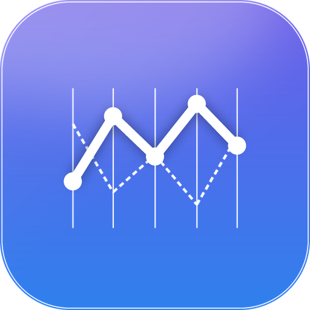
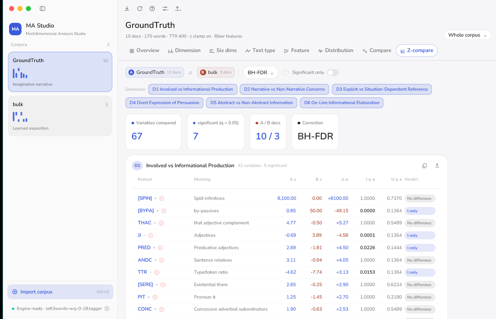

<div align="center">



# MA Studio

**Biber 多维分析（Multidimensional Analysis）的原生桌面实现 · macOS 与 Windows**

<sub>词性标注 → 统计 67 个语言特征 → 换算 z 分数 → 合成六个维度 → 判定文本类型</sub>

**简体中文** · [English](README_EN.md)

[](https://github.com/Yukkokun/Multidimensional-Analysis-Studio/releases/latest) [](LICENSE)  

</div>

---

> [!IMPORTANT]
>   
> **下载哪个？**
>   
> · **Intel 芯片的 Mac** 请用 `…macOS12-universal.dmg`（macOS 12 起，Intel + Apple 芯片都能跑）
>   
> · 另一份 `.dmg` 只支持 **Apple 芯片 + macOS 14 及以上**，体积更小
>   
> · Windows 是**免安装**的 zip，解压双击 `MA Studio.exe` 即可
>
> **打不开怎么办？** macOS 若提示「无法验证开发者」，在应用上右键 →「打开」，或执行
>   
> `xattr -dr com.apple.quarantine /Applications/MA\ Studio.app`。
>
> **需要 Java 吗？** 只有导入**未标注**的原始文本时才需要本机 Java 8+ 和 Stanford tagger；
>   
> 导入已经是 `word_TAG` 形态的文本不需要 Java。


## 这是什么

MA Studio 把 **MAT（Multidimensional Analysis Tagger）** 的分析流程做成一个能点的桌面应用：

读入一批英文文本，用 Stanford tagger 标注词性，按 Biber 的框架统计 67 个语言特征，换算成

z 分数，合成六个维度的分数，再判定它属于哪种文本类型。

分析内核是原版 Perl 实现的**逐字节复刻**：同样的 token 流、同样的 `Statistics`（85 列）、

`Zscores`、`Dimensions`。不是「差不多」，是每一个数字都对得上 —— 由 golden 语料回归保证。

一句话：**能白盒复现 MAT 结果、又能交互看数据的工具。**

## 三个发布包

最新版在 **[Releases](https://github.com/Yukkokun/Multidimensional-Analysis-Studio/releases/latest)** 页面（当前版本号就是上面那个 `release` 徽章）。文件名里的 `<版本>` 随之变化：

| 平台      | 文件                                     | 适用                               |
| ------- | -------------------------------------- | -------------------------------- |
| macOS   | `MA-Studio-<版本>-macOS12-universal.dmg` | macOS 12+，**Intel 与 Apple 芯片通用** |
| macOS   | `MA-Studio-<版本>.dmg`                   | macOS 14+，**仅 Apple 芯片**（体积更小）   |
| Windows | `MAStudio-<版本>-win-x64.zip`            | Windows 10 / 11 x64，**免安装**，解压即用 |

源码按 GPLv3 第 6 条一并提供，在同一个 Releases 页面：macOS 是对应的 `…-source.zip`，

Windows 是 `MA-Studio-Windows-source.zip`（编译方法见包里的 `README-BUILD.txt`）。

给普通用户的那份 Windows 包里只有程序和许可文本，不含源码。

> 本仓库里的代码是历史快照，未必跟得上最新发布版。**要和某个版本完全对应的源码，
> 请用那个版本附带的 `-source.zip`**；两者不一致时以发布包的源码为准。

## 界面

| 维度对比 | 分布与正态性 |
| ---- | ------ |
| 维度   | 分布     |



## 功能

八个页面，从整体到逐项：

- **概览** — 词数、篇数、平均词长、类符数；文本类型排名；六个维度的卡片（点开看细节）；每个维度最接近的参考体裁
- **维度** — 单个维度的体裁分布（柱状/横向两种画法）、叠加第二个语料对比、参考数据表（可按任一列的距离排序）
- **六维** — 六个维度一起看，支持叠加对比语料
- **文本类型** — 轮廓图：当前类型、参考类型、语料均值与逐篇曲线
- **特征** — 67 个特征的频次与 z 值，可按维度筛选、只看 |z| > 2
- **分布** — 直方图 + 核密度 + 正态曲线，Shapiro–Wilk 正态性检验，并给出「两组比较该用 t 检验还是 Mann–Whitney U」的结论
- **对比** — Welch's t 检验与 Mann–Whitney U，逐特征给出显著性
- **Z 对比** — 两个语料的 z 值并排，支持 BH-FDR / Bonferroni 等多重比较校正，点表头排序

其它：

- 中英文界面随时切换，主题有「生动 / 专业」两套
- 导出 `Statistics` / `Zscores` / `Dimensions` 三个 CSV，以及维度图与文本类型图的 PNG
- 两个语料的对比可以叠加在同一个图上，也可以逐项看统计检验
- 单篇模式：选中某一篇，所有页面都按这一篇重算

## 快速开始

1. **导入**：点侧栏「导入语料」，选一个文件夹或若干 `.txt`，也可以直接把文件拖进窗口。
2. **看结果**：默认进「概览」，顶部八个页签切换；`Ctrl+1…8` 直接跳。
3. **导出**：工具栏「导出」——三个 CSV，或把图表存成 PNG。

语料怎么准备：

- **已标注**：每行 `word_TAG`（如 `The_DT book_NN`），直接算，不需要 Java。
- **原始文本**：一行一句，程序会调 Stanford tagger 逐篇标注。需要本机有 Java 8+，并在

  「引擎」设置里指向 `stanford-postagger.jar` 与 `left3words-wsj-0-18.tagger`。

## 快捷键

| 快捷键                 | 作用          |
| ------------------- | ----------- |
| `Ctrl+O`            | 导入语料        |
| `Ctrl+R`            | 用当前设置重跑     |
| `Ctrl+,`            | 设置          |
| `Ctrl+1` … `Ctrl+8` | 切到第 1…8 个页签 |

> macOS 上把 `Ctrl` 换成 `⌘`。

## 与 Perl 原版的一致性

这是这个项目最较真的地方。分析内核对着原版 MAT 的 Perl 源码逐条移植，并且用 golden 回归

把结果钉死：

- 四套语料 × 三层输出（token 流、`Statistics`、`Zscores`/`Dimensions`）**逐字节**比对
- 连原版的已知缺陷一起复刻（例如短文本 TTR 的 `lc(undef)` 让类型数多算 1、文件开头 1–6 个词的

  判定依赖文件结尾、`INPR` 被 `QUPR` 覆盖 ……）
- 取整规则按原版来：频次取整、z 取整、维度和**不**取整

所以同一批语料，这里的数字和原版 Perl 脚本是能对上的 —— 这也意味着「看起来奇怪的数字」往往是

原版就有的行为，不是新引入的 bug。

## 从源码构建

**Windows**（Rust）

```bash
cargo build --release -p mat-app      # 产物：target/release/ma-studio.exe
```

需要 Rust stable 与 MSVC 生成工具。源码从 Releases 页的 `MA-Studio-Windows-source.zip`

下载，其中的 `README-BUILD.txt` 有更细的说明（包括为什么没带 `.cargo/config.toml`）。

**macOS**（Swift）

用 Xcode 15 打开 `Multidimensional Analysis MacTag/` 下的工程，或用 `Tools/ui-build/` 里的脚本

从命令行构建（版本号读自 Xcode 工程）。

## 仓库结构

| 路径                                     | 内容                                                   |
| -------------------------------------- | ---------------------------------------------------- |
| `Packages/MATCore/`                    | Swift 分析内核：统计、特征表、参考数据、词性标注                          |
| `Multidimensional Analysis MacTag.zip` | macOS 应用的 Xcode 工程                                   |
| `Corpus/`                              | 示例语料（10 篇，用于演示与回归）                                   |
| `Tools/`                               | golden 回归、端到端对比、构建与图标脚本                              |
| `docs/images/`                         | README 用的截图                                          |
| Windows 版源码                            | 不在本仓库，随 Releases 以 `MA-Studio-Windows-source.zip` 提供 |

## 常见问题

**「无法验证开发者」/ 应用被系统拦下**

应用的签名没有经过 Apple 公证，首次打开请在图标上右键 →「打开」；或执行

`xattr -dr com.apple.quarantine "/Applications/MA Studio.app"`。

**导入原始文本时报找不到标注器**

程序需要 `stanford-postagger.jar` 与 `left3words-wsj-0-18.tagger` 这一对（3.1.4 代）。

在「引擎」面板里选包含它们的文件夹；或改用已标注文本。

**导入到一半卡住 / 每篇弹一个黑框**

Windows 版早期版本有这个问题（子进程管道写满后互等），现已修复，请用最新包。

**数字和别的工具对不上**

先确认是同一批文件（看语料名旁边的篇数），再确认用的是同一份 tagger。

两边算法是同一套，差异通常出在输入而不是计算。

## 许可与致谢

本项目以 **GNU GPL v3** 发布，全文见 [LICENSE](LICENSE)。第三方组件（Nunito 字体、

Stanford tagger 等）各自的许可见 [THIRD-PARTY-NOTICES.txt](THIRD-PARTY-NOTICES.txt)。

- **Douglas Biber** —— 多维分析的框架本身（*Variation across Speech and Writing*, 1988）
- **Andrea Nini** —— 原版 [MAT](https://sites.google.com/site/multidimensionaltagger/) 的作者，本项目的行为基准
- **Stanford NLP Group** —— Log-linear Part-Of-Speech Tagger（GPLv2，命令行调用，不链接代码）
- **Nunito** —— 界面字体（SIL Open Font License 1.1）

本项目与原版 MAT、Stanford Tagger 的作者无隶属关系，也不由他们提供任何担保。
